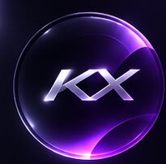
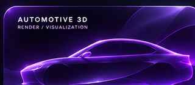

  

   

  

  <h1>Hi, I'm KAYNEX </h1>
  
<strong>3D Artist&nbsp; · &nbsp;Creative Technologist</strong>

  
Automotive Visualization&nbsp; / &nbsp;Real-Time 3D&nbsp; / &nbsp;Creative Development

  

    
    
    
  

  

    
    
    
    
  

---

## ✦ About Me

I'm a **3D Artist and Creative Technologist** focused on automotive visualization, cinematic environments, and real-time 3D. I combine visual craft with development to create polished renders, immersive scenes, and useful digital experiences.

<table>
  <tr>
    <td width="25%" align="center">
      <h3>🚘 Automotive 3D</h3>
      Vehicle visuals Materials · Lighting
    </td>
    <td width="25%" align="center">
      <h3>◈ Real-Time 3D</h3>
      Unreal Engine Environments · Cinematics
    </td>
    <td width="25%" align="center">
      <h3>⌘ Development</h3>
      Python · Flask Web tools
    </td>
    <td width="25%" align="center">
      <h3>✳ Visual Design</h3>
      Composition Editing · Presentation
    </td>
  </tr>
</table>

## ✦ Tech Stack

*Every tool icon links to its official website or documentation.*

<table>
  <tr>
    <td width="33%" valign="top">
      
<strong>3D &amp; Visualization</strong>

      

         
         
        
      

    </td>
    <td width="34%" valign="top">
      
<strong>Development</strong>

      

         
         
         
        
      

    </td>
    <td width="33%" valign="top">
      
<strong>Creative Tools</strong>

      

         
         
        
      

    </td>
  </tr>
</table>

## ✦ Featured Projects

<table>
  <tr>
    <td width="33%" valign="top">
      
      <h3>Automotive Render Series</h3>
      Cinematic vehicle renders, material studies, studio lighting, and real-time automotive scenes.
        
      
      
        
      <a href="#automotive-render-series"><strong>Explore project ↗</strong></a>
    </td>
    <td width="33%" valign="top">
      
      <h3>CyberLab</h3>
      A cybersecurity learning-platform concept with curated resources, topic guides, and practical learning experiences.
        
      
      
        
      <a href="#cyberlab"><strong>Explore project ↗</strong></a>
    </td>
    <td width="33%" valign="top">
      
      <h3>GamePulse</h3>
      A gaming-observatory concept for presenting player activity, game data, and dashboard analytics.
        
      
      
        
      <a href="#gamepulse"><strong>Explore project ↗</strong></a>
    </td>
  </tr>
</table>

## ✦ Project Notes

### 🚘 Automotive Render Series

An ongoing body of work exploring vehicle form, paint and material development, studio lighting, camera composition, and cinematic rendering.

**Workflow:** Blender · Unreal Engine · DaVinci Resolve

**Portfolio:** <a href="https://www.artstation.com/txkaylo">View selected work on ArtStation ↗</a>

### 🟢 CyberLab

A Flask-based learning-platform concept for organizing cybersecurity topics, learning resources, and practical study material in one interface.

**Workflow:** Python · Flask · HTML · CSS · JavaScript

**Stage:** In development

### 🟣 GamePulse

A dashboard concept for presenting gaming activity and player statistics through a dark, data-focused interface.

**Workflow:** Python · Flask · JavaScript · Three.js

**Stage:** Prototype

## ✦ Currently Building

<table>
  <tr>
    <td width="33%" valign="top">
      <strong>01 / AUTOMOTIVE</strong> 
      Vehicle renders, materials, studio lighting, and cinematic scenes.
        
      
    </td>
    <td width="33%" valign="top">
      <strong>02 / CYBERLAB</strong> 
      Cybersecurity learning experience, resources, and simulations.
        
      
    </td>
    <td width="33%" valign="top">
      <strong>03 / GAMEPULSE</strong> 
      Gaming data, player activity, and dashboard presentation.
        
      
    </td>
  </tr>
</table>

---

  <table>
    <tr>
      <td align="center">
        
        <h3><em>“Turning automotive passion into digital experiences.”</em></h3>
        — K A Y N E X
      </td>
    </tr>
  </table>

  

    
    
    
  

  DESIGNED WITH INTENT · BUILT BY KAYNEX

