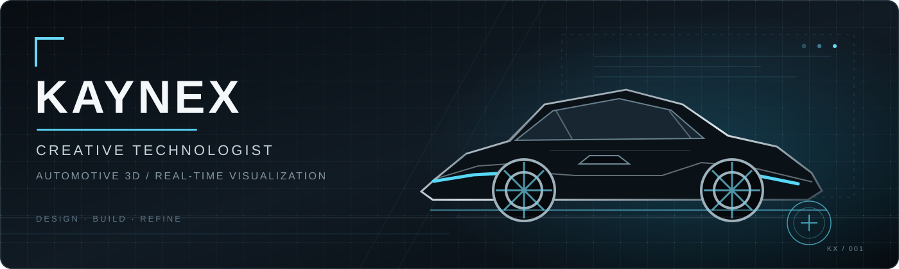

  
  <h1>KAYNEX</h1>
  
<strong>3D Artist · Creative Technologist</strong>

  
Automotive Visualization&nbsp; / &nbsp;Real-Time 3D&nbsp; / &nbsp;Creative Development

  

    
    
  

---

## About

I create automotive-focused 3D visuals, cinematic environments, and real-time scenes. I also explore software and creative tools that bring technical ideas to life.

My work is driven by visual direction, convincing materials, deliberate lighting, and clean execution.

## Focus

- **Automotive visualization** — vehicle materials, studio environments, lighting, and cinematic renders.
- **Real-time 3D** — interactive environments and presentation workflows in Unreal Engine.
- **Creative development** — Python and web experiments for useful digital experiences.

## Tools

  
  
  
  
  
  
  
  

## Selected work

| Project | Description | Stage |
|:--|:--|:--|
| **Automotive 3D** | Vehicle visualization, materials, lighting, and cinematic scene studies. | Ongoing |
| **CyberLab** | A cybersecurity learning-platform concept. | Prototype |
| **GamePulse** | A gaming-data dashboard concept. | Prototype |

## Current direction

- Developing a distinctive automotive visualization portfolio.
- Refining real-time rendering and cinematic presentation workflows.
- Building practical creative and web-based tools.

---

  Designed with intent. Built by KAYNEX.
   
  <a href="https://github.com/Kaynexx">GitHub Profile</a>

