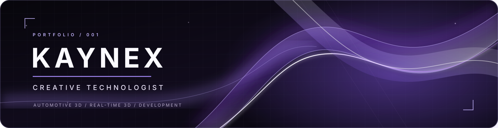
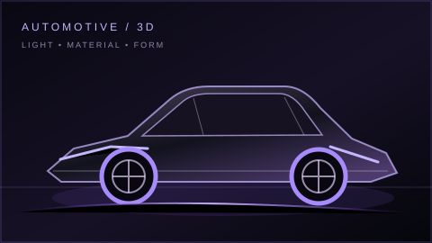
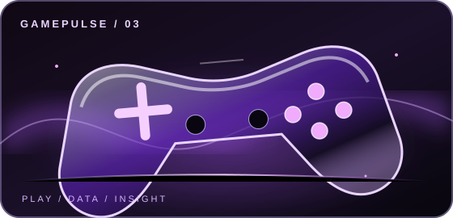

  

  <h1>Hi, I'm KAYNEX</h1>
  
<strong>3D Artist · Creative Technologist</strong>

  
Automotive Visualization&nbsp; / &nbsp;Real-Time 3D&nbsp; / &nbsp;Creative Development

  

    
    
    
  

  THE FULL LIQUID-GLASS EXPERIENCE IS THE SEPARATE PORTFOLIO WEBSITE.

---

### Selected work

<table>
  <tr>
    <td width="33%" align="center">
      <a href="https://kaynexx.github.io/Kaynexx/#work">
        
        <strong>Automotive 3D</strong>
      </a>
       Cinematic renders · Materials · Lighting
    </td>
    <td width="33%" align="center">
      <a href="https://kaynexx.github.io/Kaynexx/#work">
        
        <strong>CyberLab</strong>
      </a>
       Cybersecurity learning concept
    </td>
    <td width="33%" align="center">
      <a href="https://kaynexx.github.io/Kaynexx/#work">
        
        <strong>GamePulse</strong>
      </a>
       Gaming data dashboard concept
    </td>
  </tr>
</table>

  
<em>“Turning automotive passion into digital experiences.”</em>

  <a href="https://github.com/Kaynexx">GitHub</a>
  &nbsp;·&nbsp;
  <a href="https://www.artstation.com/txkaylo">ArtStation</a>
  &nbsp;·&nbsp;
  <a href="https://www.instagram.com/txkaylo/">Instagram</a>

